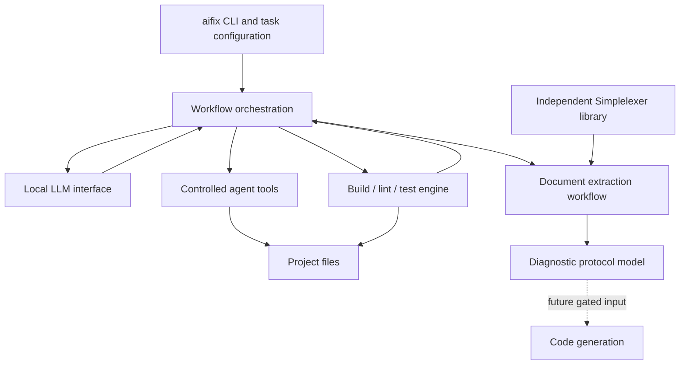
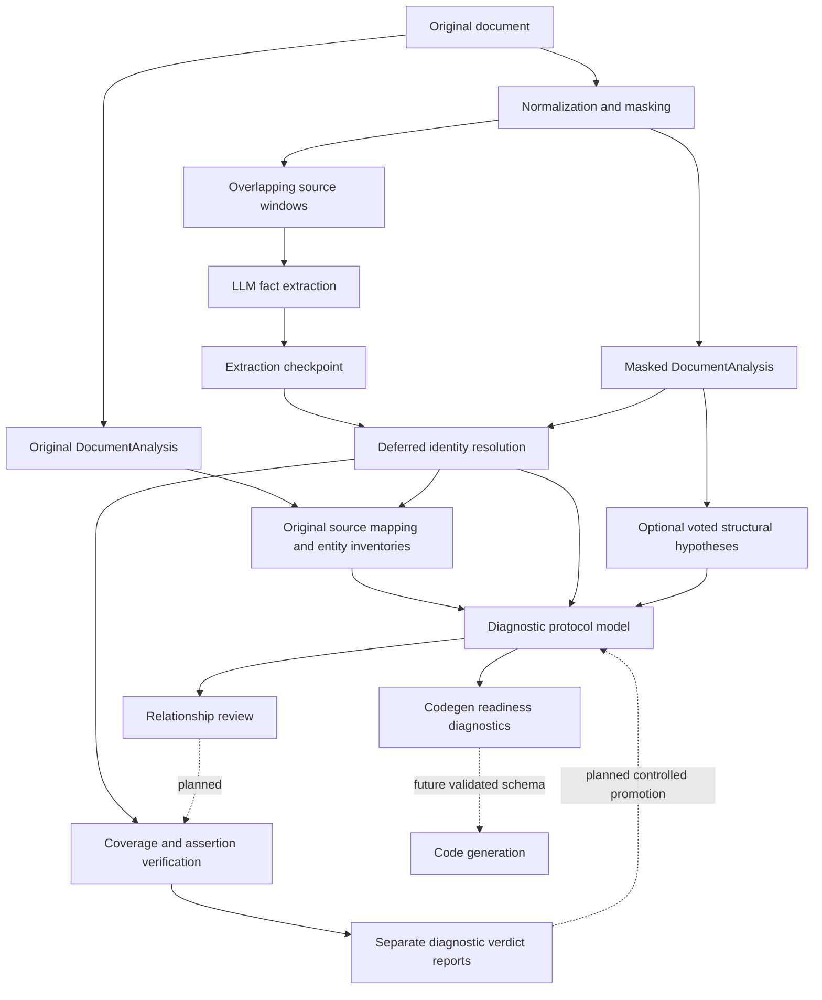
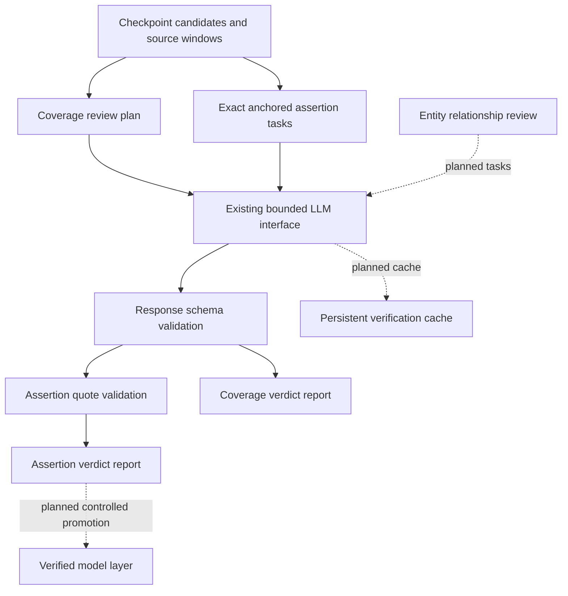
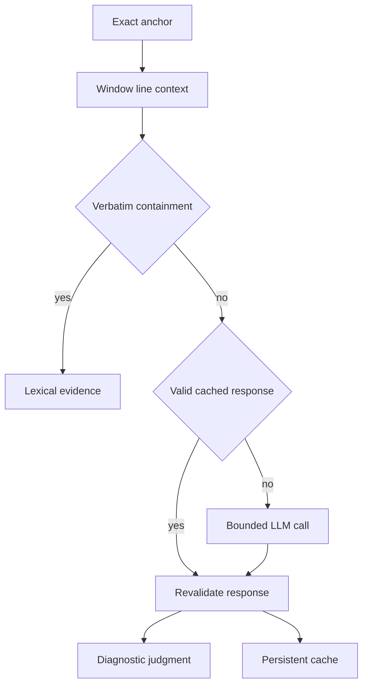

# aiagents

> **Experimental Rust project under active development.** The runtime is usable for local experiments, but generated changes and extracted specifications require independent validation.

A local-first agent runtime for AI-assisted software engineering. Rust orchestrates controlled tools and deterministic build/test checks; LLMs handle constrained interpretation and proposed edits. This is **not a security sandbox**.

## Start here

- [Documentation map](docs/README.md) — guides, diagrams, task prompts and historical reports
- [Quickstart](QUICKSTART.md) — installation and first run
- [Configuration](docs/README_CONFIG.md) — settings and file-access rules
- [Tasks](docs/tasks/README.md) — one README per task, including maturity and scope
- [Architecture diagrams](docs/architecture_diagrams.md) — workflow diagrams separated by topic
- [Runtime repair / BLT](docs/blt_execute.md) — build, lint, test and repair
- [Chunked extraction](docs/chunked_transform.md) — protocol facts, provenance and limitations
- [Extraction quality criteria](docs/extraction-quality-audit.md) — protocol-neutral acceptance tests and failure modes
- [Runtime tests](runtests/README.md) — fixtures and local results
- [TODO](TODO.md) — pending work
- [Current status and metrics](docs/current_status.md) — dated checkpoint numbers, readiness and pipeline graphs
- [Detailed status and historical results](docs/project_status_history.md) — experimental metrics and design history

## Example

```sh
aifix -l rust -t fix_code -m "Keep the constructor private and update the tests." -f "$(pwd)"
```

Use `-m` for additional literal task instructions; place it before `-a/--args`, which consumes remaining arguments.

## Task catalog

| Task | Purpose |
| --- | --- |
| [`analyze`](docs/tasks/analyze/README.md) | Analysis |
| [`build`](docs/tasks/build/README.md) | Build |
| [`extract_message_tables`](docs/tasks/extract_message_tables/README.md) | Protocol fact extraction |
| [`fix_code`](docs/tasks/fix_code/README.md) | Code repair |
| [`gen_code`](docs/tasks/gen_code/README.md) | Code generation |
| [`release_doc`](docs/tasks/release_doc/README.md) | Release notes, technical review and optional validation/revision |
| [`review_code`](docs/tasks/review_code/README.md) | Code review |
| [`review_doc`](docs/tasks/review_doc/README.md) | Document review |
| [`setup_build`](docs/tasks/setup_build/README.md) | Build setup |
| [`transpile_code`](docs/tasks/transpile_code/README.md) | Project translation |
| [`write_block_doc`](docs/tasks/write_block_doc/README.md) | Type/block documentation |
| [`write_item_doc`](docs/tasks/write_item_doc/README.md) | Item documentation |
| [`write_module_doc`](docs/tasks/write_module_doc/README.md) | Module documentation |
| [`write_test_code`](docs/tasks/write_test_code/README.md) | Test generation |

## Experimental protocol extraction

`extract_message_tables` stages source-attributed facts from overlapping document windows. The current P4 implementation keeps unresolved facts and separates uppercase/lowercase protocol identities. It does **not** guarantee semantic correctness or completeness.

To inspect a **completed** extraction checkpoint without another model call, checkpoint write or publication:

```sh
AIFIX_IDENTITY_REPLAY=1 aifix -t extract_message_tables -a document.md
```

The replay is diagnostic only. Its identity resolver still depends on local source-window signals; generic document-wide definition ownership remains work in progress. The [current status snapshot](docs/current_status.md) records the latest supplied checkpoint metrics with explicit denominators and limitations. The workflow also emits evidence-coverage, semantic-review, conservative codegen-readiness, and a **language-neutral diagnostic protocol model** (`coverage-audit.json.protocol-model.json`). That model retains lexical assemblies and voted table continuations separately from verified protocol definitions; it does not establish canonical message owners or a code-generation-ready schema. See [chunked extraction](docs/chunked_transform.md) and the [task guide](docs/tasks/extract_message_tables/README.md) for the boundaries of these reports. Historical measurements belong in [project status history](docs/project_status_history.md).

## Architecture

### Runtime and component boundaries



Rust owns orchestration, file-access policy, deterministic checks and report
generation. LLM responses are proposals, not trusted instructions or proofs.
Build-wrapper is an independent non-LLM build/test component. Simplelexer
is an independent generic library: it knows nothing about aiagents, protocol
messages, parameter ownership or LLMs. Pin its master revision by commit SHA.
Do not move workflow-specific semantic heuristics into the lexer.

### Document extraction and replay



Completed extraction checkpoints can be replayed without repeating extraction.
Optional LLM verification and structure analysis are separate opt-ins. The
default replay remains diagnostic and does not publish new canonical facts.

| Layer | Responsibility | Main implementation |
| --- | --- | --- |
| Structural analysis | Headings, tables, grids, fences, source spans | Simplelexer |
| Source adapter | Physical line coordinates, transitions, layout hypotheses | `src/workflows/source_tree.rs` |
| Extraction orchestration | Windows, checkpointing, replay, reports | `src/workflows/chunked_transform.rs` |
| Identity and entities | Source mapping, candidate identities, parameter and enum inventories | `src/workflows/message_identity.rs` |
| Voted structure | Proposed row continuations and semantic units | `src/workflows/llm_structure.rs` |
| Model projection | Language-neutral hypotheses, entities, relationships | `src/workflows/protocol_model.rs` |
| Audit and verification | Evidence coverage, review tasks, LLM judgment validation | `src/workflows/coverage_audit.rs` |

### Coordinate and evidence contract

Original-source UTF-8 byte offsets, normalized/masked document offsets,
window-relative byte offsets and physical line numbers are distinct coordinate
spaces. Never compare them directly without an explicit mapping. Exact source
mapping establishes text presence; structural-row mapping establishes context
only. A literal property is not necessarily a verified wire type. A proposed
message identity, row continuation or matching name is not semantic ownership.

### Protocol model

The additive schema-version-1 export contains message hypotheses, table
evidence, voted and hypothetical semantic units, reconstructed table entries,
assembled parameters and unassembled rows. The independent `source_entities`
inventory contains parameter definitions, assertions and literal properties,
physical enum tables, logical enum groups, logical row candidates and HTML
grids. Relationships preserve group/table/member anchors. Relationship review
records parameter assertion/property links, message parameter name candidates
and structural conflicts. Indices are local to the current export. Original
source offsets are not normalized message offsets.

No exact-name candidate is automatically promoted to ownership. Message-to-enum
references remain unresolved. Existing sidecars are retained for inspection.

### Semantic verification (P6)



Coverage review asks whether extracted statements cover a source excerpt.
Assertion review asks whether an existing statement is supported by its source.
Both reuse the existing LLM call infrastructure, temperature zero and a bounded
response budget. They are separate opt-ins.

| Environment variable | Purpose |
| --- | --- |
| `AIFIX_COVERAGE_AUDIT_JSON` | Audit output base path |
| `AIFIX_IDENTITY_REPLAY` | Replay a completed extraction checkpoint |
| `AIFIX_DOCUMENT_PLAN` | Document planning diagnostics |
| `AIFIX_SCOPED_PREFIX` | Scoped source context |
| `AIFIX_LLM_MEMORY_DIAG` | LLM memory diagnostics |
| `AIFIX_LLM_STRUCTURE` | Optional voted structure analysis |
| `AIFIX_SEMANTIC_VERIFY` | Optional coverage verification |
| `AIFIX_ASSERTION_VERIFY` | Optional assertion correctness verification |
| `AIFIX_SEMANTIC_VERIFY_LIMIT` | Per-verifier task limit, default 12, maximum 200 |

Verification flags are presence-based: unset a flag to disable it.
Assertion tasks require a nonempty exact quote at the recorded window-relative
UTF-8 offset and a nonambiguous locator. The initial implementation checks the
first eligible tasks in checkpoint order. Verdicts are supported, contradicted,
insufficient_evidence or uncertain. Supported and contradicted require a
nonempty exact substring of the supplied excerpt. Invalid responses remain
invalid rather than becoming accepted judgments. The validator checks grounding
and format, not semantic truth. Broader original-source context, relationship
verification, unresolved-fact classification, task prioritization, persistent
cache and controlled model promotion are planned, not implemented.

### Diagnostic outputs and validation gates

For an audit base of `coverage-audit.json`, suffixes include
`.protocol-model.json`, `.enum-inventory.json`, `.logical-rows.json`,
`.html-grids.json`, `.evidence-coverage.json`, `.missing-locators.json`,
`.semantic-review.json`, `.semantic-verification.json` (optional),
`.assertion-verification.json` (optional), and `.codegen-readiness.json`.
These reports are diagnostic; they are not a validated protocol specification.

Before promoting a semantic result, require explicit evidence, valid references,
conflict handling and independent evaluation. Before automatic code generation,
require a validated language-neutral schema and regression tests across multiple
independent documents. Build/test success and stable replay counters alone
cannot establish semantic correctness. Preserve extraction checkpoints when
testing new diagnostic stages.

### Implementation status

R1–R7 structural consolidation and P4 source-entity projection are implemented.
P5 projects structural relationships and unresolved reference candidates.
P6 currently implements initial assertion tasks, response validation and
opt-in execution; the new implementation still requires build and regression
validation. P6 relationship tasks, richer context, caching and promotion remain
open. P7 automatic protocol code generation is gated and not established.

## Structural analysis and semantic resolution

Simplelexer is an independent, generic structural lexer. Aiagents consumes
its source spans, document headings, table grids and logical cell lookups;
protocol identities, evidence interpretation, entity relationships and
semantic verification remain in aiagents.

The R1–R7 structural refactoring reuses document analyses and grid placements,
and delegates heading, table and fence recognition to Simplelexer. Buffered
input is not online streaming. Workflow-specific adapters remain.

The 2026-11-25 checkpoint replay reported 689 fact occurrences, 666 mapped
original-source contexts (301 exact, 365 structural-row), 57 parameter
entities with 103 linked assertions, and 31 enum members in one logical
group. Identity projection previously reported 363 facts and 284 unresolved
occurrences across 33 messages. These are diagnostic counts, not proof of
semantic correctness or complete output equivalence.

## Next extraction milestone

Complete semantic verification and relationship resolution, and explain the missing exact statement locators without confusing normalized statements with source quotations. Complete deterministic scoped-context transitions and validate a source-grounded, language-independent schema against **multiple independent documents**. Code generation remains a separate, gated project. See [current status](docs/current_status.md) and [TODO](TODO.md).

## Design and safety

- Prefer deterministic algorithms over LLM calls where practical.
- Treat verbatim source quotations as evidence of text presence, **not** semantic proof.
- File operations use configured access restrictions, but invoked build tools may execute code. Use a container or VM for untrusted projects.
- The project focuses on inspectable workflows and smaller locally hosted models rather than autonomous unsupervised changes.
- Test files live under `tests/`, mirroring the source-module directory hierarchy. See **Test layout** below.

## Test layout

Keep Rust tests separate from production source files while preserving the `src/` → `tests/` module mapping:

- `src/workflows/source_tree.rs` → `tests/workflows/source_tree_test.rs`
- `src/workflows/message_identity.rs` → `tests/workflows/message_identity_test.rs` (plus focused `message_identity_*_tests.rs` modules)
- `src/agenttools/list_dir.rs` → `tests/agenttools/list_dir_test.rs`

**Target layout:** test code belongs exclusively under `tests/` and is registered by Cargo integration-test entry points (such as `tests/mod.rs`) and their normal `mod` declarations. Production modules under `src/` must not import tests via `#[path = "../../tests/..."]`, `include!`, or equivalent test-only source inclusion. The generated production `include!` declarations in `src/lib.rs` are outside this rule.

**Migration in progress:** several existing tests still rely on private module access through `#[cfg(test)] #[path = ...]` declarations in production files. Those tests must be redesigned around supported public behavior, or their underlying functionality refactored behind a deliberate public API, **before** removing the old declarations. Do not silently drop coverage or expose internals solely to satisfy test imports. Once migrated, run `cargo test --all-targets` and `cargo fmt --check`, and verify no source-to-test inclusions remain.

## Dependencies

- [simplelexer](https://github.com/witold-k/simplelexer) — independent source-preserving structural lexer
- [struct_extractors](https://github.com/witold-k/struct_extractors)
- [fsscanner](https://github.com/witold-k/fsscanner)
- [build-wrapper](https://github.com/witold-k/build-wrapper) — independent, non-LLM build/lint/test engine (library and CLI; private repository, SSH access required while private)
- Planned underlying component: [TokenDB](https://github.com/witold-k/token_db)

## License

Apache-2.0 © 2026 Witold Kaminski. See [LICENSE](LICENSE).


### Structural consolidation: R4

R4a uses Simplelexer heading paths in the identity source adapter. The
checkpoint replay retained the previous structural counts. R4b–R4d prepare
generic source-range queries and buffered UTF-8 input in Simplelexer
(branch `feature/document-block-lookup`); integration awaits validation.
Buffered input is not online parsing and does not emit incremental events.
The existing local source tree remains until its consumers are migrated
and regression-tested in R5. Semantic interpretation stays in aiagents.

### R5: lexer-backed source tree

The local source tree now adapts Simplelexer document analysis to physical
line coordinates. Heading, table and fence recognition and buffered input
are delegated to the independent lexer. Layout hypotheses and semantic
interpretation remain in aiagents. HTML tables and stricter Markdown
recognition can change structural diagnostics; build, tests and replay
must validate the migration before it is considered complete.

### R6/R7: reuse and regression checks

Reuse the original analysis for parameter definitions and the masked analysis
for the replay source tree. Identity diagnostics share their existing section
adapter rather than parsing the same source twice. Direct string parsing avoids
an unnecessary buffered copy. Ragged rows without required columns are skipped.
Regression tests compare complete structural trees, transitions and hypotheses
for reused versus direct analysis, including UTF-8, CRLF and unclosed fences.
These tests do not establish equivalence to historical semantic output; compare
checkpoint replay sidecars separately. Remaining workflow-specific ownership
heuristics stay in aiagents.

### P4d.1: independent source entities in the protocol model

The diagnostic protocol-model JSON now includes `source_entities` in both the
baseline and optional voted-structure export. It borrows the existing parameter
resolution, physical enum tables and logical enum groups. Original-source UTF-8
byte coordinates remain distinct from normalized message evidence. Definitions
and literal properties are not validated wire types; assertions remain unverified.
No message ownership, canonical fact changes or code generation are implied.
The export is additive (schema version 1 retained). Logical groups reference
physical tables by header offset. P4d.2 adds `source_entities.logical_rows` and `source_entities.html_grids`.
Both reuse the existing original-source inventories, including unresolved rows
and covered, empty, missing or conflicting grid slots where present. These are
structural observations or proposals, not semantic relationships. The existing
sidecar exports remain available; no additional parsing or LLM calls are needed.

### P5.1: source-anchored enum relationships

`source_entities.relationships` projects logical enum group membership into
explicit group-to-table and group-to-member edges. Group indices are local to
the exported inventory; table and member anchors use original source bytes.
Missing, duplicated or multiply assigned table anchors are excluded. Edges
remain structural hypotheses, not verified semantic relationships. Parameter
ownership and message-to-enum references are deferred to subsequent steps.

### P5.2–P5.5: relationship review

`source_entities.relationship_review` exposes existing parameter assertion and
literal-property links, case-sensitive message parameter name candidates, and
issues for missing or ambiguous enum table anchors, duplicate definitions and
conflicting enum members. Name matches are not ownership edges. Message-to-enum
resolution remains deferred until explicit reference evidence is available.
Indices refer to the current export; original offsets refer to original source.
No semantic verification or canonical message changes are implied.

### Assertion verification v2

The assertion task retains the exact anchor and expands it to physical line
boundaries inside its source window. This is not yet original-source structural
context; a window can still truncate a line. Exact case-sensitive containment
is reported as `verbatim_match` without an LLM call and does not establish
ownership or semantic truth. The verifier prompt requires every clause and
exception to be supported; this is a model instruction, not a deterministic
proof of completeness.



Set `AIFIX_ASSERTION_CACHE_MODEL` to an explicit model/configuration identity
(e.g. model artifact hash plus backend and inference configuration revision)
to enable persistent reuse. Change it whenever that identity changes.
Without it, cache reads and writes are disabled. The cache key includes the
identity, schema version, full prompt, task JSON, temperature and token budget.
Valid responses are revalidated on reuse. The cache is separate from extraction
checkpoints and uses a temporary file followed by rename; concurrent writers
are not supported. The cache is not a trusted semantic proof.

The assertion report schema is now 2. The limit bounds new LLM calls, not
verbatim matches or cache hits. Reports include llm_calls, cache_hits,
verbatim_matches and pending. Original-source context and relationship review
tasks remain planned.

### Evidence resolution (P6.8–P6.9)

Assertion review preserves the original anchor and searches its source window
for a unique exact statement occurrence when the expanded anchor does not
contain the statement. The report records evidence_resolution and the selected
context offset separately from the original anchor offset. Repeated alternative
matches are not selected. Unresolved anchors remain diagnostic review tasks.
Relocation is lexical evidence, not proof of ownership. The verifier explicitly
distinguishes subject, property, scope, declarations and allowed values.
The changed task and prompt invalidate old cache keys without deleting caches.
Original-source table/section resolution and deterministic semantic relationship
validation remain open.

### P6.10 Original anchor context

Assertion review schema v3 reuses validated original-source spans from the
existing table-role audit and the existing Simplelexer DocumentAnalysis.
Original context records exact versus structural-row mapping, original byte
spans, heading indices, and bounded physical row/header text and cells.
It describes the original anchor, not a relocated statement. Window evidence
and original coordinates remain separate; exact quote validation still uses
the window excerpt. No ownership inference or new parsing is performed.
Original context changes the cache key; existing cache entries are retained.
Heading text, relocated original spans and logical grid-cell context remain
future work.

### P6.10b Relocated original evidence

Schema v4 preserves original_context and independently maps unique relocated
statements into relocated_original_context using exact byte mapping or a
unique unchanged physical source row. Missing or ambiguous mappings remain
null. The verifier must not use the old anchor context for relocated statements.
No cache deletion or canonical model changes occur. Heading text and logical
cell context remain open.

### P6.10c–e Structural verification context

Schema v4 includes heading_path (heading text, level and original byte span)
and table.logical_cells (existing Simplelexer grid slots and origin spans).
Original and relocated anchors use the same source mapping helper, preserving
missing, ambiguous and changed-row diagnostics. Context remains advisory;
covered cells do not establish semantic ownership. Grid context is limited to
128 columns and individual text fields to 8192 bytes. No cache deletion or
schema change is required by the mapping refactor.

### P6.11a Semantic relation hypotheses

Enable with `AIFIX_RELATION_EXTRACT=1`; `AIFIX_RELATION_LIMIT` limits new
LLM calls (default 12, maximum 200). All eligible assertion tasks, including
verbatim matches, participate. The independent semantic-relations.json report
contains subject, predicate, object, conditions, scope and exact excerpt quote.
The relation-cache.json uses the explicit AIFIX_ASSERTION_CACHE_MODEL identity,
prompt, task and token budget; existing assertion caches are unchanged.
Validation checks response shape, allowed predicates and quote containment,
not semantic entailment or entity identity. Empty arrays are valid abstentions.
Relations are unverified hypotheses and do not modify the protocol model.

### P6.11b/c Typed relation hypotheses (schema 2)

Relation subjects and objects carry explicit term kinds; predicates and semantic
scopes are closed enums. Signature validation rejects incompatible declared
kinds, invalid unsigned counts and non-boolean optionality values. Parameter
counts, required constants, defaults and allowed values are distinct predicates.
Source coordinate spaces are not semantic scopes. The prompt requests one
relation per allowed value. The report remains diagnostic-only: declared kinds,
scope and exact quotes do not prove entailment or resolve entity identity.
An invalid relation rejects the entire response. Old cache entries are retained;
schema 2 uses a new cache key and does not reuse schema 1 responses.

### P6.11d Partial relation reviews (report schema 3)

This supersedes the all-or-nothing validation described above. Parse the
response as a JSON array and validate each of its first 16 items independently.
Reports retain raw_response, accepted relations, indexed rejected items with
reason/detail, and validation_status (valid, partial, invalid). An empty array
is a valid abstention. response_valid remains true only for fully valid responses.
Malformed JSON cannot be partially recovered. Unknown enum variants are reported
as invalid_schema with the deserialization error detail.

The extraction prompt and cache key version 2 are unchanged: existing valid
responses are reused, and newly returned raw responses are cached even when
invalid. This prevents repeated failed responses from starving later tasks
when caching is enabled. Transport failures still abort the workflow and are
not cached. Previously discarded responses must be requested again. No cache
entries are deleted. All accepted relations remain unverified hypotheses.

### P6.11e/f Recovery and targeted retries (report schema 4)

On JSON EOF errors only, recover a contiguous prefix of up to 16 complete
objects using the JSON deserializer. Each recovered object undergoes normal
validation; truncation remains a rejection and never yields a fully valid
review. Other syntax errors are not repaired.

AIFIX_RELATION_RETRY_LIMIT (default 0, maximum 200) enables additional calls
for partial or invalid primary reviews, with a budget of min(model maximum,
4096). Persistent model identity is required for new retries. Retry responses
have separate cache keys and are reported under retry, without replacing or
merging primary hypotheses. Cached retries are read even when the new-call
limit is zero. One retry per task/configuration is cached, including failures.
Primary cache keys and prompt are unchanged. retry_calls and retry_cache_hits
are separate from primary counters. No semantic verification is performed.

### P6.11g Mixed semantic hypotheses (report schema 5)

The extraction array now supports kind=relation (existing typed relations),
kind=behavior (actor, action, optional target/trigger/timing, conditions,
modality and polarity), and kind=instance (example, entity, property, value).
Legacy untagged static relations remain accepted by the validator. Each kind
has separate field validation and exact evidence checks; all share the
16-item response limit and partial/EOF recovery. Reports expose relations,
behaviors and instances separately, including in retry reviews.
Behavior terms and instance references remain unresolved strings, not formal
events or verified identities. Modality and polarity are model hypotheses.
The changed prompt uses primary cache key version 3 and retry version 2;
older entries remain stored but are not reused for the new prompt.

### P6.11h Conservative normalization (independent diagnostic schema 1)

The relation extraction writes coverage-audit.json.normalized-hypotheses.json
alongside the unchanged schema-5 extraction report. Primary and retry accepted
hypotheses are grouped by assertion review index, kind and identical fields
after trimming outer whitespace of top-level strings. Evidence is excluded
from the grouping key but retained per occurrence with origin and item index.
Case, internal whitespace, condition order, negation and modality are preserved.
No cross-assertion entity identity is inferred. Potential conflicts are
otherwise identical behavior hypotheses with differing modality or default
relations with differing object. These are diagnostics, not proven contradictions.
Group indices refer to this report only. The original report, prompt, cache
keys and cache entries are unchanged. No additional model calls are introduced.

### P6.12a Document-scoped entity registry

The existing protocol-model report now includes source_entities.entity_registry
(schema 1). It projects message candidates (candidate ID, not verified message
identity), parameter definitions (original byte offset), physical enum tables
(header offset), enum members (table header and row offset), and logical enum
groups (sorted physical header offsets). IDs are scoped to one document
snapshot, not stable across source edits or independent extraction runs.
Duplicate IDs retain all entries and are listed in ambiguous_ids; consumers
must not resolve ambiguous IDs automatically. Names are labels, not identity
keys. No reference resolution, ownership inference, additional parsing or
model calls are introduced. The outer protocol-model schema remains additive.
