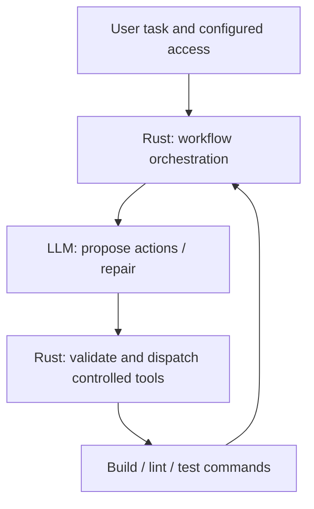
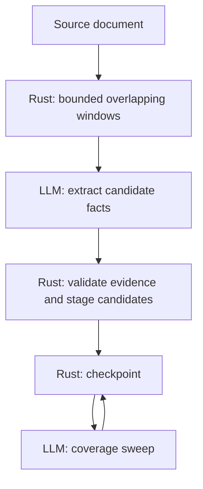
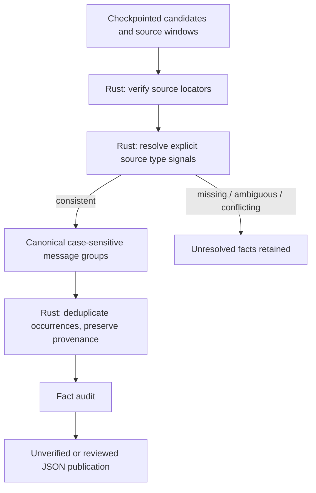
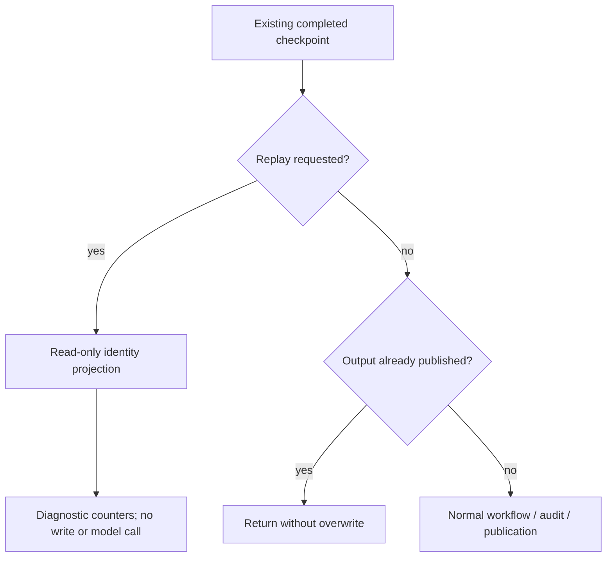
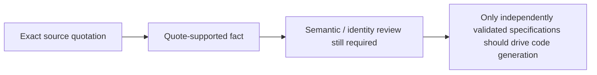

# Architecture diagrams by topic

These diagrams describe responsibilities, not a claim of semantic correctness.
Labels distinguish **LLM** from **deterministic Rust** operations without relying on color.

## 1. Runtime and repair workflow



See [BLT execution](blt_execute.md) for the detailed repair cycle and its limitations.

## 2. Chunked document extraction



## 3. Identity projection and provenance



The current resolver is **window-local** despite the document-wide goal. It does not
yet construct a generic document-wide definition index. An explicit type signal
does not by itself prove that a message is defined rather than reserved or only
mentioned in examples. The diagnostic replay is read-only and stops before
audit/publication.

## 4. Resume and diagnostic replay



Replay example:

```sh
AIFIX_IDENTITY_REPLAY=1 aifix -t extract_message_tables -a document.md
```

## 5. Verification boundaries



A byte-for-byte matching quotation is **not** semantic verification.
For detailed extraction behavior, see [Chunked Transform](chunked_transform.md).
