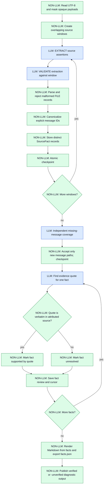
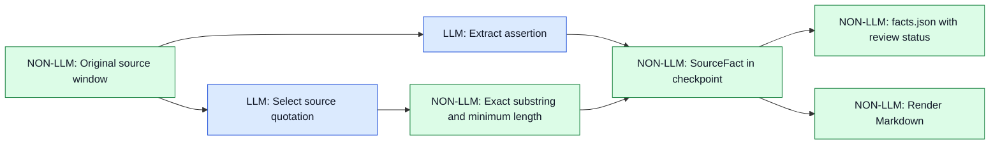

# Chunked Transform — source-grounded message extraction

## Purpose and design rationale

`extract_message_tables` transforms a large UTF-8 Markdown or text protocol
document into per-specification JSON files and a machine-readable `facts.json`.
It **does not** generate code, nor does it prove protocol correctness.

The design deliberately separates **LLM interpretation** from **deterministic
state management**. Protocol prose, tables and exceptions cannot reliably be
parsed with one generic Rust grammar, so an LLM proposes assertions. Rust
owns source slicing, destination validation, identity normalization,
checkpointing, evidence-string verification and output publication.

The original design merged whole Markdown files and repeatedly asked an LLM
to rewrite and approve them. The OpenAMIP 55-window run exposed four failure
modes: accumulated `general.md` exceeded the 20,000-character context
limit; overlapping windows repeated assertions; a file-level audit repeatedly
proposed rejected edits; and historical checkpoint material was attributed
to source windows without proof. Raising the context limit or adding retries
would not fix these architectural problems.

The revised invariant is:

> **Extracted facts are the persistent source of generated Markdown.
> Review operates on one fact and its attributed source window, never
> by rewriting an entire destination file. A verbatim quote is necessary
> evidence, not a proof that the claim is semantically correct.**

## Architecture

Colors follow [BLT Execute Workflow](blt_execute.md):
**blue = LLM**, **green = NON-LLM**. Labels repeat the distinction so the
diagrams remain readable without color discrimination.



A second diagram emphasizes the **data ownership** boundary:



## Source windows and extraction

Source text is split into windows of **4,000 Unicode characters** with
**1,000-character overlap**. Each window records its source line range.
Explicit image data URIs and very long encoded runs are masked while keeping
character positions; the source file is not changed. Long single lines can
produce multiple windows with the same line range.

For every nonempty window the LLM performs EXTRACT followed by an independent
VALIDATE request. The accepted response must contain `=== FILE: ... ===`
records or `NO_MESSAGE_DEFINITIONS`. Rust rejects nested, truncated,
unsafe or otherwise malformed records. The parser is a **framing validator**,
not a semantic protocol validator.

Allowed destinations are `general.md`, `infrastructure.md`, and
`messages/<lowercase-slug>.md`. An explicit `Message X` or `Command X`
heading can canonicalize a single-character protocol identifier to
`messages/x.md`. Descriptive aliases without an explicit identifier are
**not guessed**. Identity collisions and semantic aliases still need
additional source-grounded normalization.

## JSON extraction and unmatched evidence

Extraction now requests a JSON `files` array containing atomic assertions and
source quotations. The model must copy evidence from the source window without
reconstructing grammar productions, punctuation or HTML entities. Rust accepts
only quotations that match the source (allowing whitespace differences and
supported HTML entity encodings) and stores the original source bytes.

An unmatched quote is **not** proof. The workflow retries once with instructions
to omit any assertion for which no verbatim quotation can be found. If both
responses are structurally valid, supported assertions from either response are
combined. Any assertion still lacking a matching quotation is retained as
`unresolved`, with its source window and no `evidence_quote`; it is never
silently marked supported. This also marks the run unverified and allows the
next source window to proceed. Malformed JSON or unsafe paths still fail if
both attempts cannot produce a structurally valid response.

The existing v5 checkpoint and fingerprint remain compatible so already
completed source windows do not need to be re-extracted. The later fact audit
may establish missing evidence; unresolved output is published separately
rather than presented as reviewed.

## Persistent facts and projections

The checkpoint stores a map from destination path to `SourceFact` entries.
Each entry contains:

- `statement`: one Markdown assertion block, deduplicated by exact text
- `source_chunk`, `start_line`, `end_line`: attribution to the extraction window
- `evidence_quote`: optional verbatim substring selected during review
- `review`: `pending`, `supported`, or `unresolved`

Contradictory or paraphrased statements remain separate. Neither exact
deduplication nor a quotation proves semantic equivalence or correctness.
The source line range is the **window range**, not an exact per-assertion
line number. This representation is not yet a typed protocol-field schema.

Markdown files are rendered from fact statements. They are **not independently
edited during audit**, preventing divergence between the Markdown and
`facts.json`. The 20,000-character cap on the accumulated Markdown file
has been removed; individual extraction fragments remain bounded.

## Coverage and fact-level audit

After extraction, a separate coverage sweep checks source windows for missing
message identities. It may add new `messages/*.md` destinations, but cannot
overwrite existing files or add shared-rule destinations. Malformed model
responses receive one retry. A second failure is logged as a coverage gap,
checkpointed, and marks the result unverified.

Fact audit v1 reviews **one fact at a time** against its recorded source
window. The LLM must return either `UNSUPPORTED` or a JSON object containing
`evidence_quote`. Rust checks that the quotation is at least 12 characters
and occurs verbatim in that window. Missing attribution, an oversized fact,
a missing quote or malformed output marks the fact `unresolved`. Each result
and the cursor are checkpointed atomically. A failed review is **not retried
in a second full-document audit pass**.

This intentionally replaces the old file-level `REVISE` / JSON text edit /
independent `APPROVE` loop, which was expensive, repeatedly rejected changes,
and could leave `facts.json` inconsistent with edited Markdown. In the current
implementation **no fact is silently deleted or rewritten** based on an LLM
judgment. Unsupported statements remain visible in the diagnostic draft.
A future version can introduce explicit, independently validated
fact-level add/replace/reject operations.

### Why a verbatim quotation is not enough

The deterministic check establishes only that the quoted bytes exist in the
given source window. It does **not** establish that the quotation entails the
whole extracted assertion, that the message identity is correct, or that
another section of the protocol does not contradict it. Consequently
`supported` means **quote present**, not formally verified semantics.
Manual review is still required before using the output to generate
production protocol code.

## Checkpoints, compatibility and resume

The existing v5 checkpoint filename is retained:
`<input-stem>_messages.v5.checkpoint.json`. It contains extraction progress,
coverage progress, files, facts and fact-review cursor. Existing extraction
results are preserved when upgrading from the old file-audit workflow; the
obsolete file-audit cursor is discarded.

Historical checkpoints may have missing or inaccurate per-fact provenance.
A file without fact records is imported with an explicit **unattributed**
source marker rather than fabricating a source window. Such facts are
unresolved. Facts already migrated by earlier interim versions may have
window-level attribution that is not reliable; the presence of a quote
does not retroactively repair that historical uncertainty. Existing
`unresolved_findings` flags remain sticky.

An interrupted run resumes at the last checkpointed fact. Keep the checkpoint:
deleting it would require repeating expensive LLM extraction and coverage.
If the source or extraction prompts change, fingerprint validation rejects
an incompatible resume.

## Output and safety boundary

Output is staged and published without overwriting an existing directory.
The generated tree includes:

```text
<input-stem>_messages[-unverified]/
├── README.md
├── facts.json
├── general.md
├── infrastructure.md
└── messages/
    └── <message-id>.md
```

Any unresolved finding produces only the sibling `-unverified` diagnostic
directory and retains the checkpoint. The diagnostic README explicitly warns
against treating the files as verified protocol specifications.

### Current limitations and next steps

- Facts are Markdown blocks, not typed fields, offsets, constraints and
  versioned message schemas.
- Alias resolution is limited to explicit one-character headings.
- Exact quotations do not establish semantic truth or completeness.
- Earlier checkpoints can contain falsely attributed historical facts.
- Unsupported facts are marked, not removed or automatically corrected.
- Coverage can miss messages when the model produces malformed records.
- The source window may be much larger than an individual assertion; source
  ranges are approximate.

These limits are explicit by design: a bounded, inspectable diagnostic result
is preferable to an expensive loop that appears to converge without reliable
evidence.

## Implementation references

- `src/workflows/chunked_transform.rs`: source slicing, extraction, facts,
  checkpointing, quote validation and publication
- `task_descriptions/tasks/extract_message_tables.md`: extraction requirements
- `task_descriptions/workflow_steps/chunked_transform_*.md`: extraction,
  validation and legacy audit prompts
- `tests/workflows/chunked_transform_test.rs`: parsing and chunking tests
- `docs/blt_execute.md`: diagram color convention and LLM/non-LLM separation

## JSON output (schema version 1)

The workflow publishes **JSON instead of Markdown specifications** in a separate
`<input-stem>_messages-json` directory (or `-unverified` diagnostic sibling).
It preserves the existing v5 checkpoint filename, so extraction and fact-audit
progress from an earlier Markdown-output run can be reused. Existing Markdown
output directories are not overwritten.

- `general.json`, `infrastructure.json`, `messages/<slug>.json`:
  `schema_version`, `name`, `facts`, `source_windows` (1-based),
  and `verification` (`supported_quotes`, `unresolved`, or `no_facts`).
- `facts.json`: the complete per-original-path fact map for compatibility
  with previous structured fact consumers.
- `manifest.json`: `schema_version`, `source`, `verification`
  (`reviewed` or `unverified`), `files` and `facts_file`.

Each fact retains `statement`, `source_chunk` (0-based internal index),
`start_line`, `end_line`, `evidence_quote`, and `review`.
A `supported` fact has a matching verbatim source quotation, **not a proof
of semantic correctness**. Historical facts can have unknown provenance
(`source_chunk` = maximum usize, lines 0). Their statements may still
contain Markdown syntax: the first JSON migration changes the **serialization
format**, not the LLM extraction contract or fact semantics.

Rust owns JSON serialization and output path validation. The LLM never
formats final JSON. The manifest's global verification flag remains
conservative when earlier coverage/audit warnings were recorded.

## Structured extraction v1 (new runs)

The extraction phase now requests a JSON `files[]` array containing atomic
`statement` and verbatim `evidence_quote` pairs. Rust rejects malformed
JSON, invalid paths, empty/oversized statements, and source quotes shorter than
12 characters or absent from the current window. A rejected window is retried
once; if it still fails, the workflow stops **without advancing that window's
checkpoint cursor**, so the same window can be retried after fixing the model
or prompt. Earlier completed windows remain checkpointed.

Facts accepted with a verified substring are marked `supported` immediately.
The later audit skips those facts, avoiding redundant per-fact LLM calls.
The independent coverage sweep still uses the legacy FILE-record contract and
may introduce facts that need subsequent auditing. This is an incremental
migration, not yet a fully JSON-native coverage pipeline.

The extraction fingerprint includes `structured-extraction-v1`; old
Markdown-era checkpoints cannot be silently resumed with a different extraction
contract. Move an incompatible checkpoint aside if you want to preserve it.
A valid source quotation does **not** establish semantic entailment, and
unsupported but plausible facts can still be proposed by the LLM.
