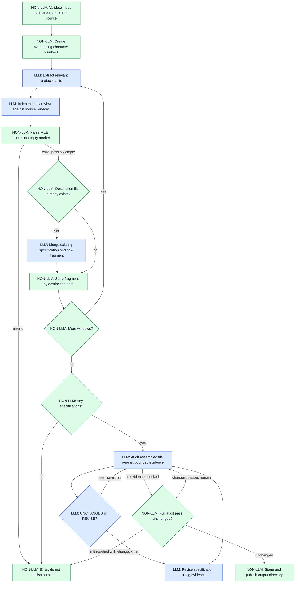
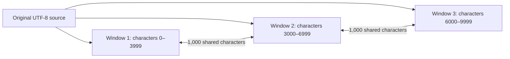
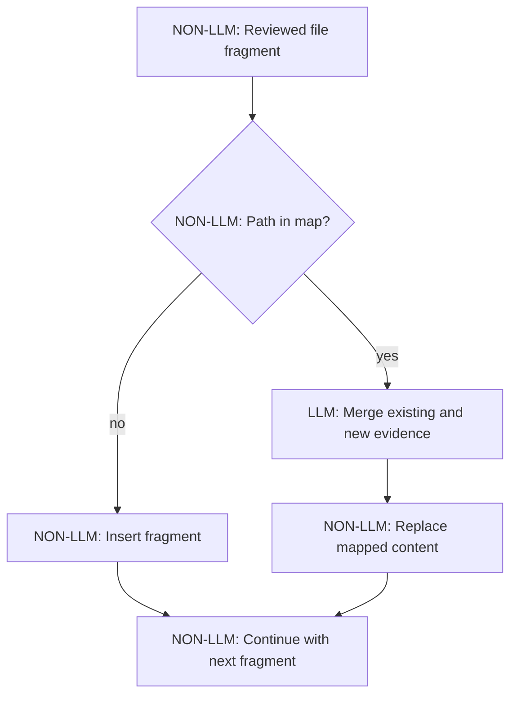
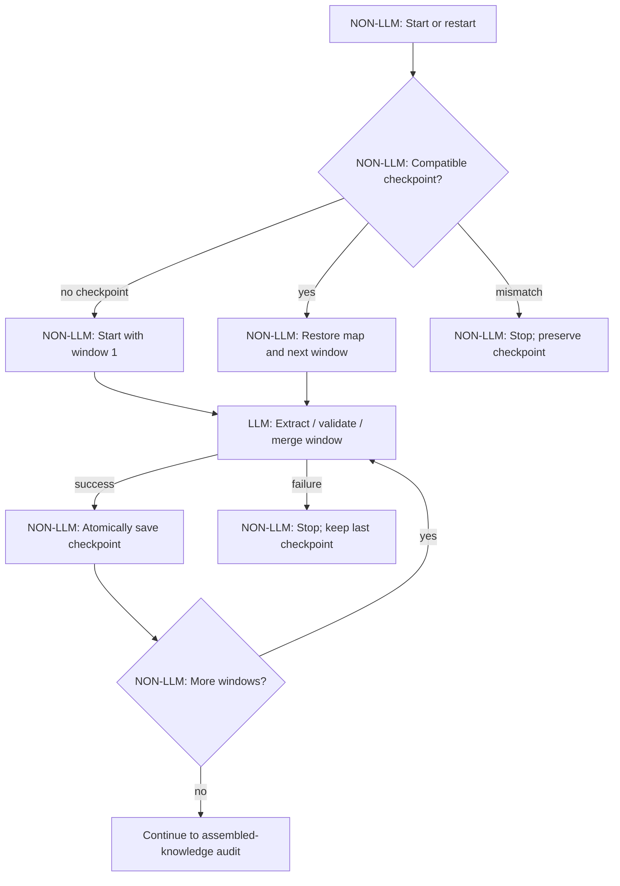
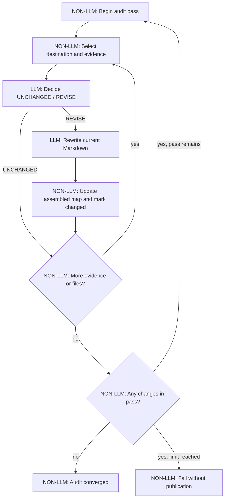

# Chunked Transform — Message Table Extraction

## Purpose

The `extract_message_tables` task transforms a potentially large UTF-8
Markdown or plain-text protocol document into **formal Markdown specifications**.
It does not generate serializers, deserializers, tests, or executable code.
Those are separate future tasks.

`ChunkedTransformWorkflow` provides the orchestration. The task and workflow
step prompts provide the protocol-specific extraction and review rules.
The input format is deliberately not parsed by the Rust workflow.

A central rule is:

> The LLM extracts and reviews protocol facts; deterministic code controls
> source windows, response framing, file paths, and publication. An LLM review
> is not an independent proof of semantic correctness.

## Execute flow

The diagram labels **LLM** and **NON-LLM** steps explicitly. Colors, if
rendered, are secondary.



The diagram is conceptual: a complete audit pass iterates over every
destination and its evidence items. The `UNCHANGED` decision advances to
the next evidence item; `REVISE` replaces the current file content and also
advances. After the last item, the workflow decides whether another pass is
necessary.

## 1. Input and bounded windows (NON-LLM)

The task requires **exactly one** `.md` or `.txt` path supplied after
`-a`. The input must exist inside the project directory. The source is
read as UTF-8 and is not modified.

The implementation splits the source into windows of **4,000 Unicode
characters** with **1,000 characters of overlap**. Splitting does not depend
on headings, line breaks, tables, or embedded data; even a single very long
base64 line remains bounded. Each window carries informational original line
ranges. Several windows may have the same line range if one source line is
longer than a window.



These offsets illustrate the window size and stride; the final window may
be shorter. The overlap helps retain definitions crossing a boundary but
also creates duplicated evidence that the merge must reconcile.

## 2. Extraction and independent review (LLM)

For **each** window, the workflow makes two separate model requests:

1. **EXTRACT:** derive message fragments, shared protocol rules, and
   justified helper contracts from that source excerpt.
2. **VALIDATE:** compare the extracted draft with the **original excerpt**
   and return a complete corrected set of file records.

The reviewer receives the excerpt and the draft, not the whole source.
It checks fields, offsets, sizes, constraints, source references, and
unsupported assertions.

Many windows contain no relevant protocol facts. Front matter, embedded
images, base64 payloads, or unrelated prose can appear **before, between,
or after** message definitions. Such windows should produce exactly
`NO_MESSAGE_DEFINITIONS`, without creating a placeholder `general.md`
or any other file record.

The model is instructed to use one of two mutually exclusive forms:

```text
NO_MESSAGE_DEFINITIONS
```

or:

```text
=== FILE: general.md ===
# Shared protocol facts
...
=== END FILE ===
=== FILE: messages/example-message.md ===
# Message specification
...
=== END FILE ===
```

The deterministic parser accepts only `general.md`,
`infrastructure.md`, and `messages/<lowercase-slug>.md`. It rejects
unclosed or nested records, empty fragments, unsafe destination paths,
extraneous text, and a response mixing file records with the empty marker.
It does **not** validate the truth of the Markdown content.

## 3. Incremental merge (LLM + NON-LLM)

Reviewed fragments are collected in a map keyed by destination path.
A new path creates a new entry. If an entry already exists, the LLM
merges the existing Markdown with the new reviewed fragment. The prompts
require preservation of source conflicts and uncertainties rather than
inventing a resolution.



The merge context is limited to **20,000 characters**. Exceeding this
limit fails explicitly; hierarchical merging of oversized individual
specifications is not yet implemented.

## Resume after interruption (NON-LLM)

After each **fully processed** source window (including its validation and
all required merges), the workflow atomically writes a JSON checkpoint next
to the intended output directory, named `<input-stem>_messages.checkpoint.json`.
It stores the next window index and the assembled file map. The checkpoint
also contains a version and a fingerprint of the source text and extraction,
validation, and merge prompts.

On the next invocation with the same source and prompts, the workflow prints
`## [CHUNKED] RESUME` and skips completed windows. A failure during a window
repeats **that window only** on restart. The checkpoint is retained on
errors and removed after successful publication. If the source or relevant
prompts changed, the workflow refuses to reuse the checkpoint and asks for
manual removal or relocation; it does not silently restart.

The checkpoint currently covers the extraction/merge phase. The later
assembled-knowledge audit does **not** yet have fine-grained resume points,
so an interruption during audit reruns the audit. A checkpoint written by
older versions is not available retroactively: the first run with this
implementation must process the document from the beginning.



## 4. Iterative assembled-knowledge audit (LLM + NON-LLM)

After all windows have been processed, the workflow audits the **assembled
files**, rather than stopping after one review per source window.

For `infrastructure.md`, the evidence consists of the assembled message
specifications and `general.md`. The goal is to detect missing necessary
helpers as well as unjustified generic abstractions. For other destination
files, the evidence consists of each original source window.

For each destination/evidence pair, the model first returns exactly
`UNCHANGED` or `REVISE`. A revision request triggers a second model call
to produce the corrected Markdown. The workflow repeats full audit passes
until a pass makes **no changes**, with a maximum of **two passes**.
If the limit is reached without convergence, the workflow returns an error
instead of publishing the directory.



**Important limitation:** Each audit call sees only a bounded evidence
item. It cannot prove completeness against the entire document at once.
The current implementation can make many model calls for large documents,
and a partial evidence window must not be treated as proof that facts from
other windows are false. Convergence means only that the model requested no
further changes under these checks.

## 5. Output publication (NON-LLM)

On successful assembly and audit, the workflow stages the files in a
temporary sibling directory and renames that directory to:

```text
<input-stem>_messages/
├── README.md
├── general.md
├── infrastructure.md
└── messages/
    ├── <stable-id>.md
    └── ...
```

The generated `README.md` indexes the message files and identifies the
source. `general.md` describes shared protocol rules;
`infrastructure.md` describes formal helper contracts; each
`messages/*.md` contains one message/version specification.

If the model supplied no shared rules or helper contracts, the current
implementation inserts corresponding placeholder Markdown files.
An existing output directory is **not overwritten**. Errors before
publication do not produce a completed output directory; staging cleanup
is attempted if publication fails.

## Failure behavior and current limitations

- An empty input, invalid path, unsupported extension, malformed model
  response, oversized merge/audit context, missing specifications, or
  non-converging audit produces an explicit workflow error.
- Extraction and review are LLM operations, not deterministic semantic
  checks. The workflow cannot guarantee that every message and field in
  a large source has been recovered correctly.
- Stable message identity across distant windows depends on the model
  using consistent destination names.
- Intermediate merge results are not structurally verified as Markdown
  specifications, and the current audit has a finite two-pass limit.
- The model's output budget is currently **2,048 tokens per call**.
  Long individual specifications may exceed this budget.
- The current generated README's verification note is conservative and
  does not constitute a proof of full-document validation.
- Comprehensive end-to-end tests with large, irregular protocol documents
  and efficient hierarchical reconciliation remain future work.

## Progress markers and tests

Normal progress includes:

```text
## [CHUNKED] EXTRACT 1/55 (lines 1-1)
## [CHUNKED] VALIDATE 1/55
## [CHUNKED] MERGE messages/example-message.md
## [CHUNKED] AUDIT 1/2: infrastructure.md against messages/example-message.md
## [CHUNKED] WROTE /path/to/document_messages
```

The exact number of windows depends on input size. The first source line
can appear in many windows when it contains a long embedded payload.

Tests are kept outside `src/`, following the repository convention:
`tests/workflows/chunked_transform_test.rs` and
`tests/workflows/select_workflow_test.rs`. They currently exercise window
coverage/overlap, Unicode and oversized lines, response framing/path
validation, and workflow selection. They are not a substitute for a
real-document end-to-end extraction test.

## Implementation references

- `src/workflows/chunked_transform.rs`: windowing, orchestration, merge,
  audit, and publication.
- `src/workflows/select_workflow.rs`: task-to-workflow selection.
- `task_descriptions/tasks/extract_message_tables.md`: task-level LLM
  requirements and file-record protocol.
- `task_descriptions/workflow_steps/chunked_transform_*.md`: extraction,
  validation, merge, and audit prompts.
- `task_requirements/extract_message_tables.md`: implementation brief and
  acceptance criteria.
