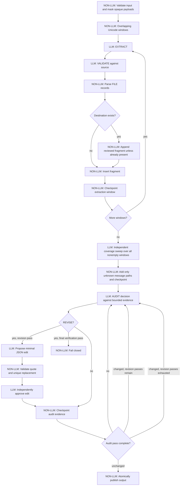
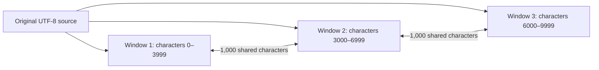

# Chunked Transform — Message Table Extraction

## Purpose

The `extract_message_tables` task transforms a potentially large UTF-8
Markdown or plain-text protocol document into **formal Markdown specifications**.
It does not generate serializers, deserializers, tests, or executable code.
Those are separate future tasks.

`ChunkedTransformWorkflow` provides the orchestration. The task and workflow
step prompts provide the protocol-specific extraction and review rules.
The input format is deliberately not parsed by the Rust workflow.

A central rule is:

> The LLM extracts and reviews protocol facts; deterministic code controls
> source windows, response framing, file paths, and publication. An LLM review
> is not an independent proof of semantic correctness.

## Execute flow (v5)

The workflow separates model decisions from deterministic safeguards:



The diagram omits retry and error edges for readability. Every rejected model
response or unsupported edit fails without publishing output. Checkpoints allow
resuming at the last completed extraction, coverage, or audit item. At most two
audit passes may apply revisions; if both change content, a third **read-only**
verification pass must report no further required changes.

## 1. Input and bounded windows (NON-LLM)

The task requires **exactly one** `.md` or `.txt` path supplied after
`-a`. The input must exist inside the project directory. The source is
read as UTF-8 and is not modified.

The implementation splits the source into windows of **4,000 Unicode
characters** with **1,000 characters of overlap**. Splitting does not depend
on headings, line breaks, tables, or embedded data; even a single very long
base64 line remains bounded. Each window carries informational original line
ranges. Several windows may have the same line range if one source line is
longer than a window.



These offsets illustrate the window size and stride; the final window may
be shorter. The overlap helps retain definitions crossing a boundary but
also creates duplicated evidence that the merge must reconcile.

## 2. Extraction and independent review (LLM)

For **each** window, the workflow makes two separate model requests:

1. **EXTRACT:** derive message fragments, shared protocol rules, and
   justified helper contracts from that source excerpt.
2. **VALIDATE:** compare the extracted draft with the **original excerpt**
   and return a complete corrected set of file records.

The reviewer receives the excerpt and the draft, not the whole source.
It checks fields, offsets, sizes, constraints, source references, and
unsupported assertions.

Many windows contain no relevant protocol facts. Front matter, embedded
images, base64 payloads, or unrelated prose can appear **before, between,
or after** message definitions. Such windows should produce exactly
`NO_MESSAGE_DEFINITIONS`, without creating a placeholder `general.md`
or any other file record.

The model is instructed to use one of two mutually exclusive forms:

```text
NO_MESSAGE_DEFINITIONS
```

or:

```text
=== FILE: general.md ===
# Shared protocol facts
...
=== END FILE ===
=== FILE: messages/example-message.md ===
# Message specification
...
=== END FILE ===
```

The deterministic parser accepts only `general.md`,
`infrastructure.md`, and `messages/<lowercase-slug>.md`. It rejects
unclosed or nested records, empty fragments, unsafe destination paths,
unsafe control markers, and structurally incomplete file records. It tolerates
common model formatting noise: outer Markdown fences, per-record Markdown
fences, introductory or closing prose, and an extra empty marker after
complete records. It does not repair truncated or nested records.
It does **not** validate the truth of the Markdown content.

## 3. Lossless incremental accumulation (NON-LLM)

The previous v5 implementation required the LLM's full-text MERGE result to
contain the entire existing specification verbatim and then requested another
model approval. Real-world runs repeatedly failed this contradictory contract:
the merge prompt asked for deduplication while the guard prohibited rewriting.

The workflow now accumulates independently reviewed fragments
**deterministically**. The previous text is never rewritten. A fragment
already present verbatim is skipped; a distinct fragment is appended with a
Markdown separator. This avoids the repeated unsafe-merge / REJECT failures
and preserves all validated fragments. It is **not semantic deduplication**:
overlapping facts, repeated headings, and contradictions may remain. The later
audit can propose narrow, source-grounded corrections, but does not guarantee
a fully normalized document.

The assembled specification is bounded to 20,000 characters per file. If
it grows beyond that limit, the run stops with its checkpoint preserved;
hierarchical consolidation is not implemented. The historical MERGE prompt
is still part of the v5 extraction fingerprint for checkpoint compatibility,
but the LLM MERGE step is no longer invoked.

## 4. Checkpointing and resume (NON-LLM)

v5 uses a sibling checkpoint named
`<input-stem>_messages.v5.checkpoint.json`. Earlier v1–v4 checkpoints
are **not deleted or migrated**. A v5 run starts extraction afresh.
The checkpoint stores the source fingerprint, next extraction chunk,
assembled files, source-window provenance, and the independent coverage
cursor (`coverage_next_chunk`). It is written atomically after every
completed extraction or coverage window.

Once coverage finishes, the checkpoint also stores the audit prompt
fingerprint, pass number, file index, evidence index, changed flag, and
revised file map. Each completed evidence decision is saved together with
the corresponding state. On failure, the last successful checkpoint is
retained; restarting repeats only the incomplete step. A changed source
or incompatible prompt/checkpoint stops the run instead of silently
discarding progress. Successful publication removes the v5 checkpoint.

The checkpoint path is beside the source/output, **not in `/tmp`**.
A displayed `RESUME at chunk 56/55` means all 55 extraction chunks have
already completed, not that extraction is restarting.

## 5. Independent coverage and iterative audit (LLM + NON-LLM)

### Coverage sweep

After extraction and merge, v5 sends **every nonempty masked source window**
to a second model check, including windows whose initial result was
`NO_MESSAGE_DEFINITIONS`. The context includes the known message-file
paths. The model must return FILE records for **new message identities only**
or the empty marker. Existing files are not overwritten by this stage. If the model emits `general.md` or `infrastructure.md` during coverage, that record is logged and ignored; the coverage cursor still advances. Such records are not treated as message discoveries.
The cursor and new files are checkpointed after each window.

Malformed coverage FILE records trigger one retry with a stricter framing
instruction and a doubled output-token budget. If the retry also fails to
parse, the window is checkpointed as processed and a
`COVERAGE WARNING ... discovery for this window is incomplete` message is
printed. No fragments from either malformed response are admitted. This
avoids repeated failures at the same window, but means the coverage sweep
can finish **with gaps**; successful completion must not be interpreted
as a completeness guarantee. Warnings should be retained for manual review.

This improves detection of omissions but remains a second **LLM judgment**,
not a guarantee of completeness. It also does not prove that all fields
within already known messages were captured. False new identities and
inconsistent naming remain possible.

### Evidence audit

After coverage, `general.md` is checked against the union of windows
associated with extracted files; message files are checked against their
own recorded source windows. `infrastructure.md` is checked against
`general.md` and the assembled message specifications. These are
targeted checks, **not** an exhaustive per-message scan of every source
window.

For each evidence item, a model first returns `UNCHANGED` or `REVISE`.
Invalid decisions get one bounded retry. Revisions require a JSON object
with `evidence_quote`, `old_text`, and `new_text`. The runtime checks
that the quote appears verbatim in the evidence, is at least 12 characters,
and that `old_text` occurs exactly once in the existing specification.
The JSON may be wrapped in a complete Markdown code fence, normalized
through `stringutils::strip_code_fences`. A malformed edit receives one
retry; `UNCHANGED` on that retry advances without modification. A proposed
edit must then pass a separate model approval call before it is committed.

The workflow permits **two revision passes**, plus a third, **read-only**
verification pass when required. A complete pass with no revisions
converges. If the final verification pass still requests a revision, the
workflow fails without publishing. A bounded number of passes prevents
unlimited automatic rewriting; convergence does not establish formal
correctness.

## 6. Output publication (NON-LLM)

On successful assembly and audit, the workflow stages the files in a
temporary sibling directory and renames that directory to:

```text
<input-stem>_messages/
├── README.md
├── general.md
├── infrastructure.md
└── messages/
    ├── <stable-id>.md
    └── ...
```

The generated `README.md` indexes the message files and identifies the
source. `general.md` describes shared protocol rules;
`infrastructure.md` describes formal helper contracts; each
`messages/*.md` contains one message/version specification.

If the model supplied no shared rules or helper contracts, the current
implementation inserts corresponding placeholder Markdown files.
An existing output directory is **not overwritten**. Errors before
publication do not produce a completed output directory; staging cleanup
is attempted if publication fails.

## Failure behavior and current limitations

- Failures preserve the v5 checkpoint. Incompatible source or prompt
  fingerprints stop resume rather than deleting state.
- Merge preservation is deliberately strict and may reject legitimate
  reorganization or deduplication; the independent merge approval is
  still model-based.
- The second coverage sweep adds one model call per nonempty window,
  beyond extraction/validation, merge verification, and audit calls.
- A known message whose fields were omitted is not repaired by the
  coverage sweep merely because its identity is already in the inventory.
- The audit uses provenance-filtered windows and may miss facts in
  windows that extraction failed to associate with the right file.
- Oversized merge/audit contexts, malformed records, rejected edits,
  non-convergence, or output-directory conflicts stop publication.
- The usual model output limit is 2,048 tokens; a malformed VALIDATE
  FILE response gets one retry with twice that budget.
- No deterministic semantic proof or large-document end-to-end
  verification is currently available.

## Progress markers and tests

Normal progress includes:

```text
## [CHUNKED] EXTRACT 1/55 (lines 1-1)
## [CHUNKED] VALIDATE 1/55
## [CHUNKED] MERGE messages/example-message.md
## [CHUNKED] RESUME at chunk 20/55
## [CHUNKED] COVERAGE 1/55\n## [CHUNKED] AUDIT CHECK 1/2: infrastructure.md against messages/example-message.md
## [CHUNKED] WROTE /path/to/document_messages
```

The exact number of windows depends on input size. The first source line
can appear in many windows when it contains a long embedded payload.

Tests are kept outside `src/`, following the repository convention:
`tests/workflows/chunked_transform_test.rs` and
`tests/workflows/select_workflow_test.rs`. They currently exercise window
coverage/overlap, Unicode and oversized lines, response framing/path
validation, and workflow selection. They are not a substitute for a
real-document end-to-end extraction test.

## Implementation references

- `src/workflows/chunked_transform.rs`: windowing, orchestration, merge,
  audit, and publication.
- `src/workflows/select_workflow.rs`: task-to-workflow selection.
- `task_descriptions/tasks/extract_message_tables.md`: task-level LLM
  requirements and file-record protocol.
- `task_descriptions/workflow_steps/chunked_transform_*.md`: extraction,
  validation, merge, and audit prompts.
- `task_requirements/extract_message_tables.md`: implementation brief and
  acceptance criteria.

### Embedded image payloads

Long inline `data:image/...;base64,` payloads are replaced with whitespace
before splitting source into windows for extraction and audit. The replacement
preserves the source's character count and line positions, so existing
extraction checkpoints retain their window indices. The original source file
and its checkpoint fingerprint remain unchanged. Completely blank windows are
skipped without an LLM call.

When resuming a checkpoint created before this behavior, the completed
extraction and its file map are preserved, but the audit cursor is reset once:
earlier audit decisions used unmasked evidence. The reset is logged. Arbitrary
base64-like protocol fields are not masked; only explicit image data URIs are
targeted.

**Limitation:** Existing extracted files that falsely describe encoded image
data are *not* automatically deleted: their names alone cannot establish that
they are unsupported, and deleting them could lose genuine protocol facts.
Such records still require source-grounded review. Masking reduces noise and
cost, but is not a guarantee of semantic correctness.


### Source provenance and clean restart (v2)

New runs use a separate `.v2.checkpoint.json` sibling file. Previous
`.checkpoint.json` files remain untouched; extraction starts again rather
than reusing the earlier audit revisions.

The checkpoint stores `source_windows` for each validated destination file.
Message audits use only windows that produced a validated fragment for that
message. Shared-rule audits use the union of protocol-bearing windows.
Infrastructure audits continue to use the generated message specifications.
Every source window still receives independent extraction validation.

This is a provenance filter, not proof of semantic correctness. Message
identity must be explicitly supported by source evidence. No records are
deleted solely on the basis of their filenames.

### Clean v3 restart and encoded evidence

The new workflow uses a separate `.v3.checkpoint.json` beside the input;
existing v1/v2 checkpoints are retained unchanged. It masks very long
base64-like contiguous tokens (512 or more ASCII characters) in addition to
explicit image data URIs, while preserving character positions and line
numbers. Short protocol fields remain intact. This is a heuristic: unusually
long legitimate protocol tokens may also be hidden, so review the source and
results if such tokens carry semantic meaning.

Malformed validation FILE responses receive one retry with a doubled output
token budget. Audit prompts now require explicit evidence for revisions;
unsupported changes remain a model-quality risk, not a mechanically proven
property. These changes intentionally require a clean v3 extraction rather
than resuming v2's already revised specifications.

### Audit v4: evidence-grounded minimal edits

The v4 workflow uses a separate `.v4.checkpoint.json`, leaving v1-v3
checkpoints untouched. This requires fresh extraction because older checkpoints
may already contain unsafe full-file audit rewrites.

When an audit decision requests a correction, the model must produce JSON
with a verbatim evidence quote, exact old text, and replacement text. The
runtime requires a substantial quote in the current evidence and an exact,
unique old-text match in the specification. It then asks for independent
approval before applying the replacement. Rejected or malformed changes stop
the run without advancing the checkpoint cursor; the original file is kept.
The check is not a mathematical proof of semantic correctness. It prevents
unconstrained full-file rewriting and makes unsupported edits observable.


### Rejected audit edits

An audit edit is accepted only when its `old_text` occurs exactly once in the current specification and the source quote is verbatim. If both the original edit and its retry fail validation, the workflow prints `AUDIT WARNING: unresolved edit`, retains the specification unchanged, checkpoints the next evidence position, and continues. This prevents repeated failures on the same evidence, but **the warning is an unresolved finding, not a successful verification**. Inspect warnings before trusting or publishing generated specifications. The final read-only audit still runs; it can refuse output when a correction remains necessary.

### Bounded audit verification context

After deterministic validation of a proposed edit (unique `old_text` occurrence and verbatim source quote), the independent verifier receives the source evidence and the proposed edit JSON rather than two complete copies of the accumulated specification. This keeps verification bounded as the specification grows. The verifier must still explicitly approve the evidence-supported replacement; a rejected edit is not applied.

The independent audit edit verification is further restricted to the validated verbatim `evidence_quote`, `old_text`, and `new_text` fields; neither the full source window nor the full destination specification is repeated. If even these fields exceed the context budget, the edit is left unapplied, an explicit unresolved `AUDIT WARNING` is logged, and the audit checkpoint advances.

An independent verifier response other than `APPROVE` is an unresolved audit finding, not a reason to re-run the same evidence indefinitely. The proposed edit is discarded, `AUDIT WARNING: edit not independently approved` is logged, and the checkpoint advances without modifying the specification. The final verification pass can still reject output if the discrepancy persists. Preserve and review warnings.

### Diagnostic output when final verification fails

The read-only final verification pass logs every unresolved `REVISE` decision as `VERIFICATION WARNING` and continues to the end. If any such findings remain, the workflow writes a **diagnostic draft only** to a sibling directory suffixed `-unverified`, prints `WROTE UNVERIFIED DRAFT`, and retains the checkpoint. It does **not** publish that draft at the normal verified output destination. The draft must not be treated as validated protocol specifications. When the final pass finds no corrections, normal output and checkpoint cleanup are unchanged.
