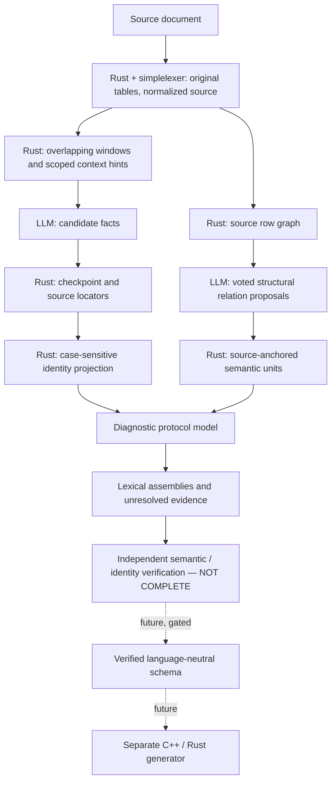
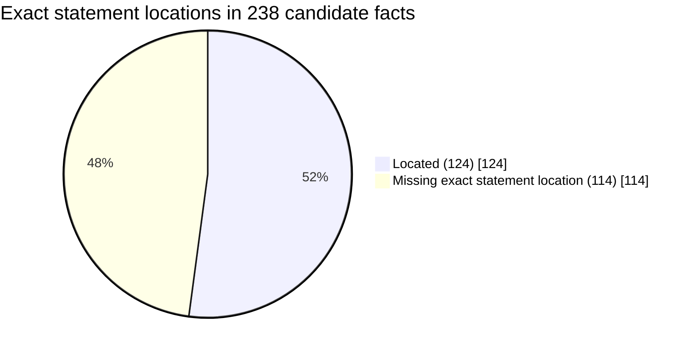

# Current project status — 2026-11-12

[Overview](../README.md) · [Architecture](architecture_diagrams.md) · [Extraction](chunked_transform.md) · [History](project_status_history.md) · [TODO](../TODO.md)

> **Evidence scope:** Source inspection on `feature/protocol-model-semantics` plus the supplied completed-checkpoint replay and JSON diagnostics. These are **not** fresh end-to-end extraction results or proof that the latest commits compile. The replay's source document is one historical protocol example; the production design must remain protocol-independent.

## Workstream status

| Workstream | Implemented / observed | Missing or unverified |
| --- | --- | --- |
| Local-first agent runtime | Rust orchestration, controlled file tools, configured model service, task catalog | Not a security sandbox; local model results are not CI |
| Build / lint / test repair | Ordered deterministic checks and LLM repair loop | Standalone LLM-independent BLT API, robust reporting and broader benchmarks |
| Chunked extraction | Overlapping source windows, recovery, checkpointing, evidence staging, coverage, publication | Complete scoped state across internal window transitions and document-wide identity resolution |
| Table and structure analysis | Original and normalized `simplelexer` views, source graph, voted row-continuation hypotheses | Verified reconstruction of damaged cells and multi-document generalization |
| Diagnostic protocol model | Case-sensitive candidate messages, table evidence, lexical declarations, semantic units and unassembled rows | Canonical ownership, conditional constraints, complete verified parameter schema |
| Code generation | Diagnostic prerequisite report | Verified language-neutral schema and separate generator; not ready |
| Documentation / release workflow | Git-based release notes and bounded technical review | Review quality and validation remain best-effort |

## Observed checkpoint metrics

| Measure | Value | Interpretation |
| --- | ---: | --- |
| Message candidates | 25 | 15 explicitly typed, 10 unresolved; not canonical messages |
| Source-attributed facts | 238 | 235 distinct statement/evidence pairs |
| Exact statement locators | 124 / 238 (52.1%) | Text-location evidence only |
| Missing exact statement locators | 114 / 238 (47.9%) | Not necessarily missing source evidence |
| Source-backed parameter assertions | 78 | 39 distinct parameters across 3 sections in this checkpoint |
| Parameter-like unmatched facts | 13 | Diagnostic structural gap |
| Normalized explicit lexer tables | 15 | 156 rows, 405 cells; source pre-normalization count was 18 |
| LLM structure attempts | 3 valid / 3 | 18 proposed relations; not independent semantic verification |
| Voted semantic units | 3 | Proposed row continuations |
| Hypothetical semantic units | 1 | No lexical entry anchor; excluded from verified coverage |
| Reconstructed table entries | 3 | Uninterpreted column fragments in row order |
| Assembled lexical parameters | 2 | Unverified syntax-based assemblies, no message owner |
| Unassembled semantic rows | 9 | Preserve source evidence without fabricating fields |

**Denominators are not interchangeable.** A lexical declaration, a parameter assertion, an extracted fact and a semantic unit measure different things. The 124/238 locator fraction is **not** a correctness, recall or code-generation readiness score.

## Pipeline and trust boundaries

A source quote proves text presence, a majority vote proposes a relation, and a lexical assembly recognizes syntax. **None of these alone proves a protocol field or its owning message.**

## Checkpoint locator breakdown

## Priorities

1. **Verify the current branch:** `just rbuild`, `cargo fmt --check`, `cargo test --all-targets`, strict clippy; capture output and regressions.
2. **Explain missing locators:** distinguish normalized paraphrases, source quotes, repeated statements and genuinely missing evidence; never equate a missing verbatim statement with missing provenance.
3. **Complete source-scoped context:** deterministic declaration lifecycle across boundaries inside a window and across windows, without inferred ownership.
4. **Build a verified semantic schema:** explicitly separate definitions, examples, ranges, optionality, conditions, conflicts and unresolved properties; benchmark multiple independent documents.
5. **Only then consider generation:** keep diagnostic JSON and verified generator input as distinct versioned contracts.

## Documentation conventions

- This file is the **current status snapshot**. [Project status history](project_status_history.md) preserves dated results and prior design decisions.
- [Architecture diagrams](architecture_diagrams.md) describe responsibilities; [window context](window_context/README.md) distinguishes implemented behavior from planned state management.
- Graphs must identify **Rust/deterministic**, **LLM/proposed** and **future/unverified** nodes with text labels, not color alone.
- Refresh counts only from a named checkpoint and record whether the run was fresh extraction or replay.
