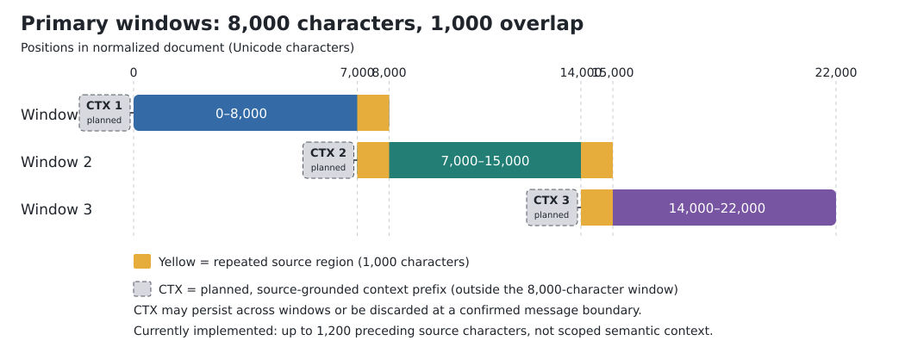
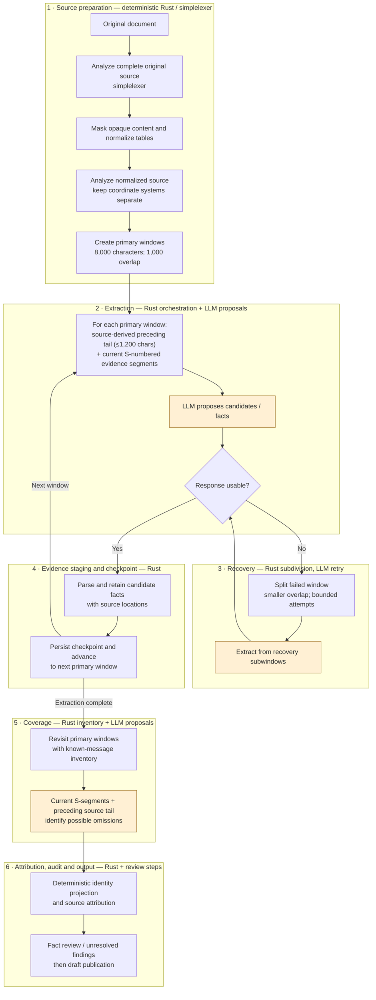

# P4 source windows and context lifetime

[Current workflow](../chunked_transform.md) · [Task overview](../tasks/extract_message_tables/README.md) · [Implementation](../../src/workflows/chunked_transform.rs)

This document distinguishes **implemented behavior** from **proposed deterministic context management**. It is a design reference, not a claim that the proposed context state machine already exists.

## 1. Current source-to-window pipeline (implemented)

1. Read the complete source in document order.
2. Run `simplelexer::tablelexer::DocumentAnalysis::parse(&source)` on the **original** document before normalization.
3. Mask opaque lines and embedded data URIs; normalize tables with `simplelexer::tablelexer::normalize_table_text()`.
4. Parse the normalized text separately. Original-source and normalized-source byte offsets are **different coordinate spaces**.
5. Call `chunks(&masked_source, CHUNK_CHARS)`. The primary extraction and coverage passes both iterate over this same list in source order.

Current constants in `src/workflows/chunked_transform.rs`:

| Parameter | Value | Meaning |
| --- | --- | --- |
| `CHUNK_CHARS` | 8,000 | Maximum number of Unicode scalar values in a primary source window |
| `CHUNK_OVERLAP_CHARS` | 1,000 | Source characters repeated between adjacent primary windows |
| `MIN_RECOVERY_CHARS` | 700 | Lower bound used when subdividing failed windows |
| `MAX_RECOVERY_WINDOWS` | 32 | Recovery processing safety cap per primary window |
| `MAX_MERGE_CHARS` | 20,000 | Bound for coverage-related context handling |

The `chunks()` function cuts on valid UTF-8 boundaries, **not** on paragraphs, headings, message declarations or table rows. It records `start_byte` in the **normalized** source and informational `start_line` / `end_line`. Adjacent line ranges may overlap. The final window can be shorter than 8,000 characters. For a window budget smaller than the overlap, the effective overlap is reduced to `limit - 1` to guarantee forward progress.

Example, using half-open character intervals:

```text
Normalized source (character offsets)
Window 1: [    0,  8000)
Window 2: [ 7000, 15000)
Window 3: [14000, 22000)
                 ^ 1000 repeated source characters per boundary
```

The overlap is intentional and remains **1,000 characters**. It protects definitions or statements crossing a window boundary, but can produce repeated candidates or facts that must be deduplicated downstream. A chunk boundary does **not** mean a message definition has ended.

## Visual guide: window mechanics (implemented)

The first diagram shows character positions in the **normalized** source. Each subsequent full-size window advances by 7,000 characters, retaining 1,000 characters from the previous window.



**Scoped context prefix (partially implemented):** Before each source window is sent to the LLM, prepend a bounded, deterministic context describing the still-applicable document/section and active message definition. This context is **additional to** the 1,000-character source overlap shown above; it is not itself part of the 8,000-character source window. When the source structure clearly closes a message definition, its message-specific context must be discarded. A chunk boundary alone must not discard it. A window may also contain an internal message boundary. Any facts emitted for a window must still be supported by evidence in the **current** window, not merely by its context prefix.

**Current behavior:** The implementation prepends both a source-derived deterministic context summary (explicit Markdown headings and `Type:` declarations) and up to 1,200 preceding source characters as a read-only hint. The summary carries, replaces and expires an explicit declaration at recognized heading boundaries. It does **not** yet understand every message-definition boundary or provide full structural scope resolution.

The drawing uses a shared horizontal source-position axis. The highlighted 1,000-character regions occur in **both adjacent windows**. Unlike Mermaid Gantt or flowcharts, this SVG preserves the actual relative positions and widths. The graphic is embedded in Markdown and renders as an image on GitHub.



The numbered boxes group responsibilities: **source preparation**, **LLM-assisted extraction**, **recovery**, **checkpointed staging**, **coverage**, and **attribution/audit/publication**. Yellow nodes indicate LLM-assisted steps; Rust owns source coordinates, parsing, progress and checkpoint state. The diagram is a simplified overview, not a claim that LLM output is verified. Recovery has minimum-size and maximum-window limits; exhausted recovery may stop extraction or mark coverage unresolved. It is **not** an unbounded retry loop. The preceding tail is a source-derived hint, not an authoritative semantic memory.

## Visual guide: scoped context (partially implemented)

```mermaid
stateDiagram-v2
    [*] --> NoActiveMessage
    NoActiveMessage --> ActiveMessage: Source-grounded message start
    ActiveMessage --> ActiveMessage: Window boundary; definition continues
    ActiveMessage --> NoActiveMessage: Deterministic message end
    ActiveMessage --> ActiveMessage: New independent definition; replace context
    ActiveMessage --> AmbiguousBoundary: Boundary cannot be established
    AmbiguousBoundary --> ActiveMessage: Source structure resolves continuation
    AmbiguousBoundary --> NoActiveMessage: Source structure confirms end
```



This diagram is the **target state machine**. The current runtime implements a conservative subset using explicit headings and `Type:` declarations; ambiguous and implicit boundaries are not yet modeled as distinct states. A message may start or end *inside* a primary window. The 1,000-character source overlap remains unchanged regardless of the active semantic context.

## 2. What the LLM receives today (implemented)

### Extraction

For a primary extraction window, the request contains the task requirements, extraction prompt, source name, chunk number, line range and the window text. When the code builds the segmented request, `segmented_source()` assigns local IDs such as `[S1]` to source segments. `evidence_segments()` splits by source lines and further splits long lines into segments of up to approximately 320 Unicode characters, preferring a ` | ` table-cell boundary where available. Segment IDs restart for each supplied source window; they are **not** document-global IDs.

The extraction prompt's segmented source is assembled directly (without a global string replacement), so source text matching a prompt header cannot accidentally replace header content.

The extraction loop also computes `preceding_extraction_context(&masked_source, part, &window)`. This is up to **1,200 characters immediately preceding the current recovery/source window**, read directly from the normalized document, not from earlier model responses. It is labeled *read-only; not evidence*: emitted facts must cite a segment from the **current** source, never the preceding-context block. For a primary window, the preceding tail can include the source overlap already present in that window; this is not a separately maintained semantic state.

The prompt warns that a heading, declaration, table boundary or unrelated section **may** terminate a type's applicability. This is an instruction to the model, **not a deterministic boundary detector**.

### Recovery

If a model response is invalid or incomplete, the current source window may be subdivided. `recovery_chunks()` uses a smaller overlap: `min(limit / 4, 256)` characters. Recovery uses the same source-derived preceding-context mechanism and local evidence segment IDs. When a recovery substring occurs more than once inside its parent chunk, the current preceding-context lookup uses the first occurrence; the separate table metadata path avoids claiming an unambiguous offset in this case. Resolving repeated recovery windows with explicit source spans remains open work.

Recovery progress and staged results can be checkpointed. Recovery does **not** introduce a durable, authoritative message-context state machine.

### Coverage

After extraction, the workflow traverses the primary windows again. Each coverage request includes an inventory of known message paths (`=== KNOWN MESSAGES ===`), the current segmented source and preceding source context. The inventory is a discovery aid, not proof of identity or completeness. Coverage is intended to discover missing message definitions rather than overwrite existing specifications.

### Identity and evidence

The workflow also has a document-wide identity context using original and normalized source analyses and row mappings. It is used for deterministic attribution/projection; it is **not** automatically serialized into every extraction prompt.

An `S`-segment locator and a quotation establish a traceable source location, not the semantic correctness of an extracted assertion. Chunk-relative offsets must not be confused with absolute offsets in the original document.

## 3. Scoped context semantics (partially implemented)

**Goal (partially implemented):** supply each LLM source window with a deterministic, bounded, source-grounded context that can be **created, carried forward, replaced and discarded**. Do not accumulate all previously extracted messages indefinitely.

Distinguish:

- **Document/section context:** applicable heading hierarchy, definitions or constraints supported by source structure; may outlive a message definition.
- **Active message context:** current message declaration and applicable fields/constraints; expires when a deterministic source boundary closes that definition or begins a distinct one.
- **Raw overlap:** the unchanged 1,000 characters repeated between primary windows, independent of semantic context.
- **Unverified LLM hypotheses:** candidate identities/facts; never silently promote these into authoritative context.

Proposed transitions:

| Source event | Intended context action |
| --- | --- |
| A message continues across a chunk boundary | Keep applicable message context |
| A clearly delimited message definition ends | Drop its message-specific context |
| A new independent message definition begins | Replace the prior active message context |
| A containing section ends | Drop context scoped to that section |
| A window contains two message definitions | Change context at the **internal source boundary**, not at the window boundary |
| A boundary is ambiguous | Keep uncertainty explicit; do not silently assign later facts to the prior message |
| A document has no tables | Continue with the same linear source-processing behavior |

The initial implementation scans complete source lines preceding the window, tracks explicit Markdown headings and `Type:` declarations, and adds a bounded read-only context prefix. A sibling/parent heading ends a heading-scoped declaration, and a new `Type:` replaces the old one. Bare `Type:` declarations remain active until a subsequent heading or declaration. This is deliberately conservative and does not yet model implicit endings, nested scope ownership, or ambiguity as an explicit state.\n\nContext must be reproducible from source positions and deterministic structure, including `simplelexer` output where available. Model-suggested Markdown or message boundaries may be hypotheses, but must not independently trigger irreversible context deletion. Do not add an HTML parser or independent table reconstruction in `aiagents`.

**Important design consequence:** a single context prefix for an entire 8,000-character window may be insufficient when the window contains multiple messages. The implementation must either represent source-scoped context changes *within* the window or use a justified boundary-aware subdivision, without changing the requirement that `simplelexer` processes the complete document.

## 4. Determinism, checkpoints and validation

- The same document and configuration should produce the same context boundaries and context text, independently of LLM responses and checkpoint/resume history.
- Context should refer to source ranges in an explicitly identified coordinate system. Keep original and normalized offsets distinct.
- Changes to window sizes, context serialization or prompts can change model inputs and invalidate comparability with existing checkpoints. Treat checkpoint compatibility as an explicit migration/versioning concern.
- Do not equate `FactReview::Supported` with semantic verification.

Required tests for the full context behavior (some initial unit tests have been added):

1. One message spanning two primary windows; the context persists.
2. Two message definitions within one window; context switches at the source boundary.
3. A clearly terminated message; the message context expires.
4. An ambiguous boundary; no unjustified message ownership.
5. A tableless document; unchanged extraction assumptions.
6. UTF-8 boundaries, overlap, recovery subdivisions and deterministic resume.
7. Original versus normalized source coordinates never silently mix.

## 5. Implementation pointers

- `chunks()`: primary overlapping source windows.
- `recovery_chunks()`: smaller recovery subdivisions.
- `preceding_extraction_context()`: current source-tail hint, **not** semantic state.
- `evidence_segments()` / `segmented_source()`: per-window evidence identifiers.
- `ChunkedTransformWorkflow` extraction and coverage loops: prompt construction and checkpoint progress.
- `message_identity::DocumentIdentityContext`: document-wide identity source information.

See [the workflow reference](../chunked_transform.md) for checkpoint fields, audit semantics and the broader consolidation plan.
